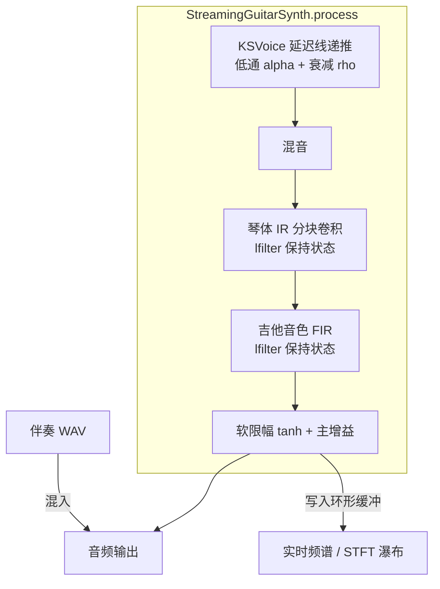
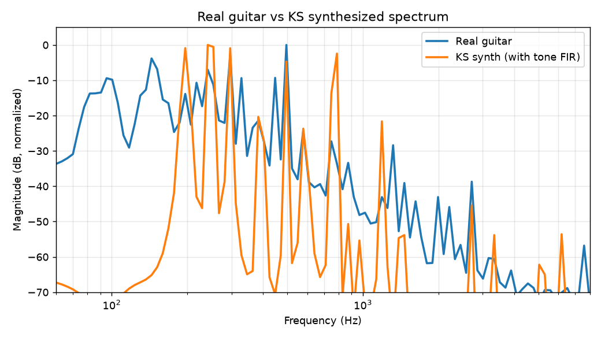

# DSP 吉他合成器

一个基于 Python + NumPy/SciPy 的吉他拨弦音频合成器，核心采用 **Karplus-Strong 物理建模**算法，并带一个 Pygame 编写的 **GUI 前端**（调参 → 选歌 → 演奏 + 实时频谱/瀑布可视化）。

## 项目简介

项目流程分为两个阶段：

1. **频谱包络提取**：从吉他 WAV 中提取「音色指纹」（频谱包络）
2. **拨弦合成**：Karplus-Strong 延迟线算法合成吉他拨弦/扫弦声音，支持离线导出 WAV、实时流式键盘演奏、琴体 IR 卷积与吉他音色整形
3. **GUI 弹唱**：Pygame 三屏前端 + 节奏引擎 + 伴奏混音 + 和弦提示（仅 A/S/D/F 四键跟弹）

## 快速开始

```powershell
# 激活虚拟环境（项目自带 .venv，包含 sounddevice / pynput 等依赖）
.venv\Scripts\Activate.ps1

# GUI 前端（调参 → 选歌 → 演奏，推荐）
python main.py --gui

# 默认模式：合成 A_minor 和弦并导出 WAV
python main.py

# 键盘实时演奏（无 GUI）
python main.py --play
```

> 全新环境请先安装依赖：`pip install -r requirements.txt`

## 运行方式

| 命令 | 说明 |
|---|---|
| `python main.py --gui` | GUI 前端：调参 / 选歌 / 演奏 + 可视化（推荐） |
| `python main.py` | 默认模式：合成 A_minor 和弦导出 WAV |
| `python main.py --play` | 键盘实时演奏（无 IR，无 GUI） |
| `python main.py --play --ir` | 键盘实时演奏（带琴体 IR） |
| `python main.py --extract` | 单独执行频谱包络提取 |
| `python scripts/generate_ks_audio.py` | 生成 KS 合成 WAV（供 A/B 听感对比） |
| `python scripts/test_streaming.py` | 无头流式合成测试（统计 xrun / CPU） |
| `python scripts/analyze_bgm.py` | 分析吉他伴奏的和弦进行与扫弦节奏 |
| `python scripts/build_guitar_tone.py` | 从真实吉他录音设计音色 FIR 滤波器 |
| `python scripts/build_anheqiao_timeline.py` | 按功能谱生成《安和桥》精确和弦时间线 |

```powershell
# 演奏模式完整参数示例
python main.py --play --alpha 0.4 --rho 0.995 --ir
```

### GUI 演奏键位（`python main.py --gui`）

主界面：拖滑杆调参数（alpha/rho/力度/音量）、IR 开关、预设方案；点「开始演奏」进选歌。

选歌界面：`↑/↓` 选曲、`←/→` 难度、`P` 试听、`Enter` 进入、`Esc` 返回。

演奏界面（歌曲模式《安和桥》）：

| 按键 | 动作 |
|---|---|
| `A` / `S` / `D` / `F` | 按和弦（Em / D / G / C，节奏自动扫弦） |
| `[` / `]` | 切换节奏模板 |
| `-` / `=` | 调 BPM |
| `B` | 开关伴奏播放 |
| 拖动底部进度条 | 跳转伴奏进度 |
| 拖动右下音量条 | 调伴奏音量 |
| `Esc` | 停止伴奏并返回选歌 |

自由演奏模式：左手 `A/S/D/F` 按和弦，右手 `空格`/`.` 下扫、`,` 上扫。

> 旧的无 GUI 键盘模式（`--play`）仍保留：A_minor/C_major/G_major/F_major + `.`/`,` 手动扫弦。

## 核心流程

```
┌─────────────────────────────────────────────────────┐
│  阶段一：频谱包络提取（extract_envelope.py）          │
│  吉他 WAV → 截延音段 → FFT → 峰值检测 → 插值包络      │
│        → assets/guitar_envelope_data.npz            │
└─────────────────────────────────────────────────────┘
                          │（当前 KS 模型暂不使用，保留扩展）
                          ▼
┌─────────────────────────────────────────────────────┐
│  阶段二：Karplus-Strong 拨弦合成（synthesizer.py）    │
│  白噪声激励 → 延迟线(N=fs/f0) → 低通(alpha)          │
│        → 增益衰减(rho) → 弦振动信号                  │
│        → [可选] 琴体 IR 卷积(ir) → 归一化           │
└─────────────────────────────────────────────────────┘
                          │
            ┌─────────────┴─────────────┐
            ▼                           ▼
   WAV 导出（generate_ks_audio.py）  实时流式演奏（keyboard_controller.py + streaming_synth.py）
```

**演奏模式调用链（GUI）**：

```
main.py --gui
  └─▶ GUI.App（main → song_select → play 三屏）
        └─▶ AppContext（引擎 + 环形缓冲 + 节奏引擎 + 伴奏混音）
              ├─▶ RhythmEngine：按住和弦 → 按模板自动扫弦 → StrumCommand
              ├─▶ 伴奏 WAV：混入输出（频谱环形缓冲只录自己弹奏的 KS）
              └─▶ StreamingGuitarSynth.process：KSVoice 渲染 → IR → 音色 FIR → 软限幅 → 输出
```

**演奏模式调用链（无 GUI 命令行）**：

```
main.py --play [--ir] [--alpha X] [--rho Y]
  └─▶ KeyboardController(use_ir=..., alpha=..., rho=...)
        └─▶ 键盘事件 → PerformanceStateMachine（演奏状态机）
              └─▶ StrumCommand / MuteCommand → StreamingGuitarSynth
                    └─▶ KSVoice × 弦数（每根弦常驻延迟线状态）
                          └─▶ 回调逐块向量化推进 → 混音 → 软限幅 → 音频流输出
```

## Karplus-Strong 算法原理

Karplus-Strong 是经典的物理建模弦乐合成算法，用一个**循环延迟线**模拟弦的振动。

### 核心思想

1. **激励**：拨弦瞬间弦上激发宽带振动，用一段**白噪声**填充延迟线模拟这一瞬态。
2. **循环**：延迟线中的样本循环流转，模拟弦上行波的来回传播：
   - 延迟线长度 $N = \text{round}(f_s / f_0)$，即一个基频周期，决定音高；
   - 每循环一步，样本经过**低通滤波**，模拟高频能量耗散；
   - 再乘以**增益系数** $\rho$，模拟能量衰减。
3. **输出**：每一步取延迟线当前样本作为输出。

### 一步更新的数学表达

记延迟线当前样本为 $x_i$、下一个样本为 $x_{i+1}$，则：

$$
x_i \leftarrow \rho \cdot \big[(1-\alpha)\,x_i + \alpha\,x_{i+1}\big]
$$

- 方括号内是**相邻两点加权平均**（低通）：$\alpha$ 越大，高频衰减越快，音色越暗；
- $\rho$ 是**增益衰减**：越接近 1，余音越长；
- 更新后指针前移一位，如此循环，直到输出长度满足要求。

### 两个关键参数

| 参数 | 范围 | 作用 | 听感 |
|---|---|---|---|
| `alpha` | 0.0 ~ 1.0 | 低通系数 | 越大越暗，越小越亮 |
| `rho` | 0.0 ~ 1.0 | 增益衰减 | 越接近 1 余音越长 |

> 离线实现见 `dsp_guitar_core/synthesizer.py` 的 `synthesize_ks_note()`，使用**索引式环形缓冲**做到每采样 O(1)，避免 `np.roll` 的 O(N) 开销。
> 实时演奏由 `dsp_guitar_core/streaming_synth.py` 的 `KSVoice.render()` 在音频回调内按 **block 级 numpy 向量化**推进，与逐样本递推逐点等价，并受声部上限 `config.MAX_VOICES` 保护。

## 琴体 IR 卷积

### 目的

Karplus-Strong 只建模了**弦**的振动；真实吉他的声音还会经过**琴体共鸣箱**的滤波与共振。IR（Impulse Response，脉冲响应）是琴体对单位冲激的响应，用它卷积可给弦声加上「箱体感」。

### 本项目中的使用方式

- IR 是**可选**的，默认关闭：纯 KS 弦声即最自然的拨弦音色。
- 开关方式：
  - 生成 WAV：`python scripts/generate_ks_audio.py --ir`
  - 键盘演奏：`python main.py --play --ir`
- 实现位置：
  - `synthesize_ks_note(..., ir=None)`：单音合成后可做卷积（保留扩展）
  - `synthesize_ks_chord(..., ir=None)`：**对混好的和弦整体卷积一次**（更符合物理，避免逐弦固定梳状滤波）
- IR 由 `generate_synthetic_ir()` 生成：短促（4ms）、低频为主、快速衰减的合成冲激。

### 调参经验（本项目实测）

| 方案 | 听感 | 结论 |
|---|---|---|
| 纯 KS（无 IR） | 自然拨弦、扫弦感 | ✅ 推荐默认 |
| 4 个离散正弦 IR | 像钢琴/钟声 | ❌ 淘汰 |
| 0.2s 密集模态 IR | 空灵、像混响 | ❌ 淘汰 |
| 4ms 短促低频 IR | 木头暖色、不拖尾 | ✅ 可选 |

## 可调参数

### 1. KS 合成参数（生成 WAV 时命令行可调）

| 参数 | 含义 | 默认值 | 终端调节 |
|---|---|---|---|
| `alpha` | 低通系数，控制亮度（越大越暗） | 0.7 | `--alpha 0.4` |
| `rho` | 增益衰减，控制余音长度（越接近 1 越长） | 0.997 | `--rho 0.995` |
| `chord` | 和弦 | A_minor | `--chord C_major` |
| `duration` | 时长（秒） | 3.0 | `--duration 2.5` |
| `ir` | 琴体 IR 卷积开关 | 关 | `--ir` |

```powershell
python scripts/generate_ks_audio.py --alpha 0.4 --rho 0.995 --chord A_minor --ir
```

### 2. IR 内部参数（`synthesizer.py` 的 `generate_synthetic_ir()` 内，需改代码）

| 参数 | 含义 | 默认值 |
|---|---|---|
| `duration` | IR 时长，越短越不拖尾 | 0.004s |
| `n_modes` | 共振模态数量 | 16 |
| `f_min` / `f_max` | 共振频率范围 | 100 / 1500 Hz |
| 振幅指数 | 低频占比（越小低频越突出） | -0.7 |
| 衰减率 | 400~1200（越大衰减越快） | 400~1200 |

### 3. 演奏模式参数

| 参数 | 含义 | 默认值 | 调节方式 |
|---|---|---|---|
| `ir` | 琴体 IR 开关 | 关 | `--ir` 命令行 |
| `alpha` | 亮度（低通系数） | 0.7 | `--alpha 0.4` 命令行 |
| `rho` | 余音长度 | 0.997 | `--rho 0.995` 命令行 |
| 扫弦力度 | 固定 0.6 | `config.DEFAULT_VELOCITY` | 改 `config.py`（后续计划按键速度映射） |

## 目录结构

```
DSP_Guitar_Synthesizer/
├── main.py                        # 主入口（命令行分发）
├── config.py                      # 全局配置与路径
├── audio_engine.py                # 核心算法聚合入口
├── requirements.txt               # 依赖清单
├── README.MD                      # 本文件
├── GUI/                           # GUI 前端（Pygame）
│   ├── app.py                     # 屏幕状态机 + 主循环
│   ├── app_context.py             # 引擎/环形缓冲/节奏/伴奏/进度
│   ├── theme.py                   # 配色与字体
│   ├── visual.py                  # VisualRingBuffer（可视化环形缓冲）
│   └── screens/                   # main_screen / song_select / play_screen
├── dsp_guitar_core/               # 核心 DSP 包
│   ├── synthesizer.py             # 合成器核心（离线 KS + 合成 IR）
│   ├── streaming_synth.py         # 流式实时合成引擎（KS + IR + 音色 FIR）
│   ├── performance.py             # 演奏状态机（按键 → 命令）
│   ├── rhythm.py                  # 节奏引擎（按住和弦自动扫弦）
│   ├── sequencer.py               # 乐谱加载 + 音序器（可选）
│   ├── fingering.py               # 和弦指法数据
│   ├── extract_envelope.py        # 频谱包络提取
│   ├── keyboard_controller.py     # 无 GUI 键盘演奏
│   └── utils.py                   # 通用工具
├── scripts/                       # 生成/分析/测试脚本
│   ├── generate_ks_audio.py       # KS 合成 WAV
│   ├── generate_simulated_guitar.py
│   ├── generate_synthesized_audio.py
│   ├── generate_test_audio.py
│   ├── test_step1.py / test_step2.py
│   ├── test_streaming.py          # 流式合成无头测试
│   ├── analyze_bgm.py             # 伴奏和弦/节奏分析
│   ├── reanalyze_anheqiao.py      # 限定和弦重新分析
│   ├── build_guitar_tone.py       # 设计吉他音色 FIR
│   ├── build_anheqiao_timeline.py # 生成安和桥和弦时间线
│   └── generate_charts.py         # 生成示例曲谱
├── plan_and_tasks/                # 规划文档（PLAN / TASK_PLAN / 会话总结）
└── assets/                        # 素材与输出
    ├── BGM/                       # 伴奏（安和桥.wav 等）
    ├── charts/                    # 曲谱与和弦时间线 JSON
    ├── guitar_tone.npy            # 吉他音色 FIR 系数
    ├── guitar_envelope_data.npz   # 提取的频谱包络
    └── synthesized/               # 合成音频输出
```

## 脚本说明

| 脚本 | 用途 |
|---|---|
| `generate_ks_audio.py` | Karplus-Strong 拨弦合成，导出 WAV |
| `generate_simulated_guitar.py` | 生成模拟吉他扫弦 WAV |
| `generate_synthesized_audio.py` | 基于频谱包络合成（旧流程） |
| `generate_test_audio.py` | 生成含泛音的测试音频 |
| `test_step1.py` | 分析 WAV 并画频谱包络图 |
| `test_step2.py` | 对比真实 vs 合成音频频谱 |
| `test_streaming.py` | 无头流式合成测试（统计 xrun/CPU 负载） |
| `analyze_bgm.py` | 分析吉他伴奏的和弦进行与扫弦节奏 |
| `reanalyze_anheqiao.py` | 限定 G/D/Em/C 重新提取安和桥和弦时间线 |
| `build_guitar_tone.py` | 从真实吉他录音设计音色 FIR |
| `build_anheqiao_timeline.py` | 按功能谱生成安和桥精确和弦时间线 |
| `generate_charts.py` | 生成示例曲谱 JSON |

## 依赖

```txt
numpy>=1.24.0
scipy>=1.10.0
matplotlib>=3.7.0
sounddevice>=0.4.0   # 实时音频输出
pynput>=1.7.0        # 键盘监听（无 GUI 模式）
pygame>=2.5.0        # GUI 前端
```

## 数字信号处理（DSP）大作业分析

### 与课程知识点的对应关系

| 课程知识点 | 本项目对应实现 |
|---|---|
| 采样与离散信号 | 44.1kHz 采样、分块（blocksize=256）流式处理 |
| 傅里叶变换 FFT / STFT | 实时频谱（`rfft` + 对数频率轴）、STFT 3D 瀑布图、包络提取（FFT + 峰值检测） |
| 窗函数 | Hann 窗用于频谱分析与包络提取，抑制频谱泄漏 |
| LTI 系统 / 滤波 | KS 一阶低通（alpha）、琴体 IR 与音色 FIR 的分块卷积（`lfilter` 带状态） |
| 卷积 | 琴体 IR 卷积、吉他音色整形 FIR 卷积 |
| 差分方程 / Z 变换 | Karplus-Strong 延迟线递推（一阶差分方程） |
| 插值 / 信号重建 | 频谱包络三次样条插值 |
| 实时信号处理 | 音频回调内零分配、样本时钟驱动、环形缓冲 |

### DSP 部分的优点

- KS 递推做了「向量化 render vs 逐样本」逐点等价验证，并覆盖高音弦 `n < blocksize` 的跨圈情况
- 音频回调内零动态分配（预分配缓冲、`lfilter` 保持状态），实测 **0 xrun**
- IR / 音色 FIR 都用保持状态的分块卷积，没有使用 `fftconvolve`

### DSP 数据流



### DSP 部分的缺点与可改进处（诚实的自评）

1. **和弦建模是简化版**：`get_chord_frequencies` 只返回根音/三音/五音 3 个音，不是 6 根弦的按弦把位，也没有低音转位（所以 D/#F 和 D 听感一样）；要更真实需做「和弦转位/把位 + 低音线」。
2. **KS 的衰减/滤波过于简单**：单一 `alpha` 一阶低通 + 单一 `rho` 增益，无法体现真实弦「高频衰减更快」的频率相关损耗；可升级为更复杂的 loop filter 或频散（dispersion）建模。
3. **激励是白噪声**：真实拨弦激励有特定的频谱形状与瞬态，白噪声偏「硬」；当前靠音色 FIR 事后整形弥补，不够物理。
4. **IR 是合成占位**：`generate_synthetic_ir` 是 16 个指数衰减正弦叠加的合成冲激，不是真实琴体实测 IR；可用真实吉他录音反卷积提取琴体 IR。
5. **和弦识别是朴素模板匹配**：chroma + 大小三和弦模板，人声/鼓点干扰大、无节拍同步、无 HMM/Viterbi 平滑；可用 librosa + 和弦 HMM 提升。
6. **缺少定量评估**：没有对合成音色做客观指标（谱质心、频谱包络误差、与真实吉他频谱的距离）的对比报告。

### 频谱对比（真实 vs 合成）

真实吉他（纯吉他版《安和桥》平均频谱）与 KS 合成（G_major，含音色 FIR）的对比：



> 由 `scripts/make_spectrum_comparison.py` 生成，可用 `python scripts/make_spectrum_comparison.py` 重新生成。
