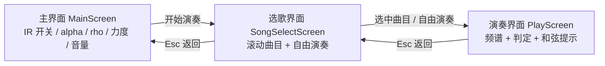
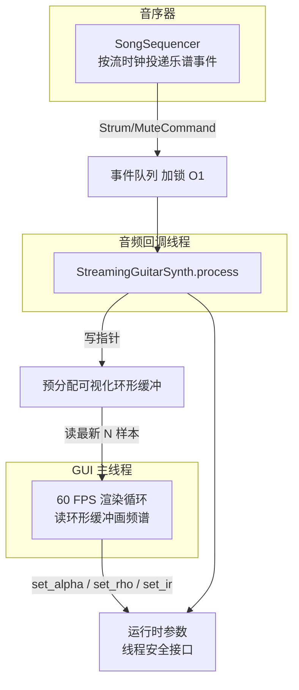

# 任务 1：GUI 前端（调参 → 选歌 → 演奏 + 可视化）— 任务清单与预期结果

> 本文是对 `PLAN.md`「任务 1：实时频谱可视化」的扩展：从 CLI 参数升级为完整三屏前端。
> GUI 框架选用 **Pygame**（60 FPS 自绘滚动列表 / 频谱，最接近 Phigros 手感）；音频继续走 `sounddevice`。

## 一、总体架构

### 屏幕状态机

### 线程模型（决定是否 xrun 的关键）

核心纪律（沿用 `PLAN.md` 第 4 节）：**音频回调内零分配**；参数改动进入回调线程生效；GUI 只读环形缓冲。

## 二、任务清单与预期结果

| # | 任务 | 关键要点 | 预期结果（验收） |
|---|---|---|---|
| T0 | 工程骨架 + 技术选型 | `GUI/` 包（`app.py` 屏幕状态机、`screens/` 三屏、`app_context.py` 共享上下文、`theme.py`）；`requirements.txt` 加 `pygame`；`main.py` 加 `--gui` | `python main.py --gui` 开窗、三屏可切换，音频流 0 xrun |
| T1 | 引擎运行时参数化（**最关键重构**） | `StreamingGuitarSynth` 加线程安全 `set_alpha/set_rho/set_master_gain`、`enable_ir/disable_ir`（IR 预生成，开关只切标志并在回调内 `_zi.fill(0)`）；已发声部跟随调参（制音声部除外）；新增 `VisualRingBuffer`（预分配 + 写指针） | 拖动滑杆音色即时变化；`test_streaming.py` 仍 0 xrun |
| T2 | 主界面（调参屏） | IR 开关 Toggle；滑杆 ×4（alpha/rho/velocity/master_gain）；参数数字显示；预设按钮；「开始演奏」→ 选歌屏 | 调参即时生效；进入选歌屏；Esc 返回 |
| T3 | 选歌界面（Phigros 式滚动） | `Song` 结构（name/bpm/难度/封面色/chart/预览）；滚轮 + 上下键 + 拖拽滚动、平滑缓动、选中居中放大高亮；难度切换；内置 ≥3 曲 + 自由演奏入口 | 列表 60 FPS 流畅；选中曲目/自由演奏进入演奏屏 |
| T4 | 乐谱 + 音序器 | `chart.json`：事件 `{time_ms, type, chord, direction, velocity}`；`SongSequencer` 以音频流样本时钟为基准、带 lookahead 投递命令；产出判定期望时间戳 | 按谱自动拨弦，节奏与音频时钟对齐无漂移 |
| T5 | 演奏界面 + 可视化 | 频谱：环形缓冲 → `rfft` → dB 频谱柱（对数频率轴）60 FPS；自由演奏保留 A/S/D/F + `,/.`；歌曲模式判定 Perfect/Good/Miss + combo + 分数 | 频谱实时滚动、有判定分数、0 xrun |
| T6 | 集成打磨 | `--gui` 一键入口（老 CLI 参数不破坏）；全流程回归；README 更新 | 一键进入前端，全链路可用 |

## 三、可视化候选（未定部分，逐步加）

1. 实时频谱（必做）：FFT 频谱柱，对数频率轴 + dB。
2. STFT 瀑布图 / 语谱图（DSP 含量最高）。
3. 六弦振动动画：读每根 `KSVoice` 延迟线能量映射 6 弦波动。
4. 波形示波器。
5. 和弦指法图（6 弦品位高亮）。
6. VU 电平表。
7. 击弦粒子特效（纯观感）。

## 四、关键风险与决策点

1. **已发声部是否跟随实时调参**：简单方案只影响后续扫弦；跟随余音需回调内遍历 voices（T1 已做，制音声部跳过）。
2. **IR 运行时开关**：回调内禁止 `fftconvolve`，沿用 `lfilter`，切换时在回调内 `_zi.fill(0)`。
3. **环形缓冲读写竞争**：单写者/单读者，允许撕裂读，无需锁。
4. **时钟基准**：音序器必须锚定音频流样本计数，否则乐谱漂移。

## 五、T2 / T3 详细任务清单（细化）

### T2 主界面（调参屏）
| 子任务 | 内容 | 状态 |
|---|---|---|
| T2-1 | IR 开关 + 4 滑杆(alpha/rho/力度/音量) + 「开始演奏」按钮 | ✅ 已完成 |
| T2-2 | 预设方案按钮：暖色 / 明亮 / 长余音 一键设置 alpha/rho | ✅ 已完成 |
| T2-3 | 参数实时数字显示（随滑杆 label 显示） | ✅ 已完成 |
| T2-4 | 键盘快捷键微调参数（可选） | ⬜ 可选 |
| 验收 | 拖动即生效、预设一键切换、点击进入选歌、Esc 返回 | |

### T3 选歌界面（Phigros 式滚动）
| 子任务 | 内容 | 状态 |
|---|---|---|
| T3-1 | 平滑滚动：选中项缓动居中（`scroll` lerp → `index`） | ✅ 本轮完成 |
| T3-2 | 选中项高亮放大 + 离中心越远越暗越小 | ✅ 本轮完成 |
| T3-3 | 滚轮 / 点击 / 上下键切换 | ✅ 本轮完成 |
| T3-4 | ←→ 难度切换（EASY/HARD/MASTER） | ✅ 本轮完成 |
| T3-5 | 曲目封面色 + 预览播放（P 键试听） | ✅ 已完成 |
| T3-6 | 自由演奏入口 | ✅ 已完成 |
| 验收 | 60 FPS 流畅、选中项居中、Enter 进入演奏 | |

## 六、待完成：演奏界面和弦提示 + 演示动画（依赖 T4）

| 子任务 | 内容 | 状态 |
|---|---|---|
| G-1 | 根据当前曲目 chart 在演奏界面显示「此时应按的和弦」（和弦名 + 指法高亮） | ⬜ 待做 |
| G-2 | 和弦提示窗口：下一个即将到来的和弦（lookahead）+ 剩余时间进度条 | ⬜ 待做 |
| G-3 | 演示动画候选：六弦振动、扫弦方向箭头、击弦粒子 | ⬜ 待做 |
| G-4 | 判定联动：按对/按错和弦时提示反馈（颜色/文字） | ⬜ 待做 |
| 依赖 | 需 T4 音序器 + chart 数据 + 判定期望时间戳；自由演奏模式显示当前按键和弦 | |

## 七、T4 乐谱 + 音序器（详细计划）

### 目标
选曲后按 chart 自动演奏：以音频流样本时钟为基准，节奏零漂移；产出判定期望时间戳，供 G-1~G-4 使用。

> 状态：✅ 已实现；**自动演奏默认关闭**（可选，后续加入歌曲音频后按需挂 `ctx.sequencer` 启用）。

### 设计
- **乐谱格式** `assets/charts/*.json`：
  - `{name, bpm, events: [{time_ms, type(strum|mute), chord, direction, velocity}]}`
- **生成脚本** `scripts/generate_charts.py`：按 BPM + 和弦进行 + 节拍模板生成 3 首示例曲谱（每拍下扫 + 第 2/4 拍后半拍上扫 + 结尾制音）。
- **`dsp_guitar_core/sequencer.py`**：
  - `load_chart(path, sample_rate)`：JSON → 按时间排序的 `(sample, 预构建 StrumCommand/MuteCommand)` 事件；和弦切换时自动插入旧和弦 `MuteCommand`。
  - `SongSequencer(engine, events, sample_rate)`：`advance(frames)` 由音频回调调用，到点派发（命令在加载时预构建，回调内零分配）；`elapsed_seconds()` / `upcoming()` / `finished` 供 GUI 查询。
- **接线**：`AppContext` 增 `sequencer` + `current_chart` 字段，回调末尾 `sequencer.advance(frames)`；`PlayScreen.on_enter` 加载曲谱建 sequencer，Esc 清空；状态栏显示曲目名 + 已播放时间。

### 验收
| 项 | 标准 |
|---|---|
| 节奏对齐 | 自动演奏节奏与音频时钟对齐，长时间无漂移 |
| 回调零分配 | 派发不新建数组/对象（命令预构建） |
| 0 xrun | `scripts/test_streaming.py` 仍 0 xrun |
| 数据接口 | `upcoming()` 返回下一事件（供 G-1/G-2 和弦提示） |

## 八、歌曲音频接入（待用户提供音频后实施）

### 音频文件约定
| 项 | 约定 |
|---|---|
| 目录 | `assets/audio/` |
| 命名 | 与曲目名一致，如 `星空.wav`、`河流.wav`、`森林.wav` |
| 格式 | WAV，**44.1kHz**（与 `SAMPLE_RATE` 一致），16-bit PCM 或 float32 |
| 声道 | 单声道或立体声均可（加载时统一转为 float32） |
| 长度 | 与对应曲谱小节数一致（星空/河流/森林各 8 小节） |

### 接入步骤
1. 新增伴奏加载与混音：回调内把伴奏样本 + KS 引擎输出混音输出（沿用零分配约束）。
2. 曲目配置（`song_select.py` 的 `SONGS`）加 `audio` 路径。
3. 播放同步：以伴奏样本时钟为基准，让 `SongSequencer` 与伴奏对齐 → 驱动和弦提示。
4. G-1/G-2：演奏界面显示当前/下一个和弦 + lookahead 倒计时 + 指法图。
5. G-4：按键判定（按键 vs 期望时间窗）。

### 和弦提示窗口（G-1/G-2）设计要点
- 数据源：`SongSequencer.upcoming()` 返回后续事件，取下一个 strum 事件的 `chord` 与期望样本时间。
- 显示：当前和弦名 + 6 弦品位指法图高亮 + 下一和弦 lookahead + 倒计时进度条。
